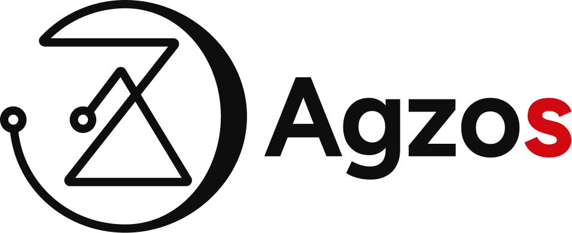

<p align="center">
  <picture>
    <source media="(prefers-color-scheme: dark)" srcset="logos/SVG/2.svg">
    <source media="(prefers-color-scheme: light)" srcset="logos/SVG/1.svg">
    
  </picture>
</p>

<h1 align="center">Agzos Code</h1>

<p align="center">
  <strong>O VS Code do time Agzos</strong> — editor de código com Electron + Monaco, IA nativa, terminal integrado e multiplataforma.
</p>

<p align="center">
  
  
  
  
</p>


---

## ✨ O que é

**Agzos Code** é um editor de código desktop construído com [Electron](https://www.electronjs.org/) e [Monaco Editor](https://microsoft.github.io/monaco-editor/), o componente de edição também usado pelo VS Code. A base é um aplicativo próprio, sem fork do Code-OSS e sem suporte à API de extensões do VS Code. A Fase 1 (Fundação) foi concluída e a Fase 2 (IA) está em andamento. Consulte o [roadmap atual](docs/plano/ROADMAP.md).

**Diferencial intencional:** o editor foi desenhado desde o dia 1 com o ecossistema Agzos em mente (IA, ferramentas internas, identidade visual) e com privacidade por padrão (telemetria desligada até opt-in explícito).

## 🎯 Features atuais (v0.1)

- **Editor Monaco** com syntax highlight, sugestões básicas, multi-cursor, bracket pair colorization, minimap e line numbers. Os language workers para IntelliSense completo entram na Fase 4.
- **3 temas do editor:** `Agzos Dark` (preto + vermelho), `Agzos Light` e `Monokai`.
- **4 estilos de ícones para arquivos e pastas**, configuráveis nas preferências: Lucide colorido, Lucide minimalista, badges técnicos e emojis. Ícones também aparecem nas abas.
- **Sidebar** com Explorer e views de Buscar, Git, Extensões e Agzos IA; Git, Extensões e IA ainda são áreas em desenvolvimento, conforme o roadmap.
- **Activity Bar lateral** estilo VS Code.
- **Árvore de arquivos** com expansão lazy, ícones por tipo de arquivo e pastas conhecidas, e menu de contexto (renomear, excluir, criar arquivo/pasta, revelar no SO).
- **Tabs com indicador de dirty** (●) e close on middle-click.
- **Quick Open** (`Ctrl+P`): busca fuzzy por nome de arquivo na workspace.
- **Buscar em arquivos** (`Ctrl+Shift+F`): varre texto nos arquivos da pasta aberta (com skip em `node_modules`, `.git`, `dist`, etc).
- **Terminal integrado** (`Ctrl+`): xterm.js conectado ao shell do sistema (bash/powershell).
- **Command Palette** (`Ctrl+Shift+P`): fuzzy matcher de comandos.
- **Status bar** com Ln/Col, linguagem, encoding, EOL, branch mock e modo de performance.
- **Top bar** com busca rápida e botões de atalho.
- **Preferências persistentes** em JSON, com segredos destinados ao cofre do sistema.
- **3 modos de performance:** Economia (animações off), Balanceado (padrão), Alta Performance.
- **Atalhos globais** estilo VS Code: `Ctrl+S`, `Ctrl+P`, `Ctrl+Shift+P`, `Ctrl+B`, `Ctrl+` `, `Ctrl+Shift+E/F/G/X`.
- **Branding Agzos:** splash screen, logo, paleta de cores em todos os elementos.
- **Builds multiplataforma** via electron-builder: NSIS (Win) + AppImage/DEB/RPM (Linux) + DMG/ZIP (macOS).

## 🧠 Roadmap

| Fase | Status | Foco |
|------|--------|------|
| **0 — Protótipo** | ✅ Concluída | Editor Electron + Monaco e identidade Agzos |
| **1 — Fundação** | ✅ Concluída | Testes, segurança, modularização e CI |
| **2 — IA** | 🚧 Em andamento | Providers, streaming, wizard e painel de chat |
| **3 — Git e GitHub** | ⏳ | Git integrado e contas GitHub |
| **4 — Editor completo** | ⏳ | IntelliSense, terminal, busca e restauração de sessão |
| **5 — Distribuição e v1.0** | ⏳ | Releases e atualização automática |

> **Decisão de arquitetura:** o projeto mantém Electron + Monaco próprio. Extensões do VS Code e marketplace Open VSX não fazem parte do escopo atual; essa decisão está registrada no [ADR-0001](docs/decisoes/ADR-0001-base-do-editor.md).

## 🚀 Quick start

### Downloads — v0.3.0

- [Windows — instalador](https://code.rsolutionsbr.com/release/Agzos%20Code%20Setup%200.3.0.exe)
- [Windows — portátil](https://code.rsolutionsbr.com/release/Agzos%20Code%200.3.0.exe)
- [macOS — Apple Silicon](https://code.rsolutionsbr.com/release/Agzos%20Code-0.3.0-arm64-mac.zip)
- [macOS — Intel](https://code.rsolutionsbr.com/release/Agzos%20Code-0.3.0-mac.zip)
- [Linux — AppImage](https://code.rsolutionsbr.com/release/Agzos%20Code-0.3.0.AppImage)

Windows e Linux consultam atualizações diretamente em `https://code.rsolutionsbr.com/release/`. No macOS, enquanto o aplicativo não estiver assinado/notarizado, novas versões são informadas para download manual.

### Pré-requisitos
- Node.js 20.x ou 22.x
- npm 10+

### Instalação
```bash
git clone https://github.com/rodrigoazevedo1988/agzos-code.git
cd agzos-code
npm install
```

O `postinstall` roda `tools/setup-vendor.js`, que copia os assets do Monaco e do xterm para `src/renderer/vendor/` (necessário por causa da CSP restritiva do renderer).

### Rodar em dev
```bash
npm run dev         # abre o app
npm run dev:tools   # abre o app com DevTools
```

### Regenerar ícones
```bash
npm run build:icons
```
Gera PNG/ICO/ICNS a partir de `logos/SVG/6.svg` usando o próprio Electron (sem dependências externas). No macOS também aplica nome e ícone Agzos no `Electron.app` de dev.

### Documentação
Veja [`docs/`](docs/README.md): PRD, decisões de arquitetura, troubleshooting e roadmap.

### Buildar instalador
```bash
npm run dist          # todas as plataformas (precisa de toolchain)
npm run dist:linux    # só Linux (AppImage + DEB + RPM)
npm run dist:win      # só Windows (NSIS + portable)
npm run dist:mac      # só macOS (DMG + ZIP, precisa de host macOS)
```

Saída vai para `dist/`.

## ⌨️ Atalhos

| Atalho | Ação |
|--------|------|
| `Ctrl+P` | Quick open (buscar arquivo) |
| `Ctrl+Shift+P` | Command Palette |
| `Ctrl+Shift+F` | Buscar texto nos arquivos |
| `Ctrl+S` | Salvar arquivo ativo |
| `Ctrl+B` | Alternar sidebar |
| `` Ctrl+` `` | Alternar terminal |
| `Ctrl+Shift+E` | Ir para Explorer |
| `Ctrl+Shift+G` | Ir para Git |
| `Ctrl+Shift+X` | Ir para Extensões |
| `Esc` | Fechar command palette |
| `Enter` (em campo de busca) | Abrir primeiro resultado |
| Middle-click em tab | Fechar tab |

## 🏗️ Arquitetura

```
agzos-code/
├── package.json              # Electron + electron-builder config
├── src/
│   ├── main/
│   │   ├── main.js          # Electron main process (BrowserWindow, IPC)
│   │   └── preload.js       # contextBridge (API segura pro renderer)
│   └── renderer/
│       ├── index.html       # Shell HTML da UI
│       ├── splash.html      # Splash de boot
│       ├── styles/app.css   # Tema Agzos (CSS variables, dark/light/monokai)
│       ├── scripts/
│       │   ├── app.js              # Entry point / costura
│       │   ├── editor.js           # Monaco wrapper
│       │   ├── tabs.js             # Sistema de abas
│       │   ├── file-tree.js        # Sidebar de arquivos
│       │   ├── icon-theme.js       # Ícones de arquivos, pastas e abas
│       │   ├── terminal.js         # xterm + shell IPC
│       │   ├── command-palette.js  # Overlay de comandos
│       │   ├── ai-chat.js          # UI stub do chat IA
│       │   ├── search.js           # Busca textual
│       │   ├── state.js            # Singleton de estado (script clássico, carregado antes do app.js)
│       │   ├── welcome.js          # Pop-up de boas-vindas
│       │   ├── onboarding.js       # Wizard de onboarding
│       │   └── toast.js            # Notificações efêmeras
│       ├── vendor/          # Gerado por tools/setup-vendor.js (gitignored)
│       │   ├── monaco/      # Monaco AMD loader + min/vs/
│       │   └── xterm/       # xterm.js + xterm-addon-fit + css
│       └── assets/          # Ícones SVG/PNG
├── build/                   # Assets do electron-builder (ícones, etc)
│   ├── icon.png            # 256x256
│   ├── icon-1024.png       # Master
│   ├── icon.ico            # Windows
│   └── ...
├── docs/                    # PRD, ADRs, arquitetura, roadmap
├── tools/
│   ├── setup-vendor.js     # Copia Monaco/xterm/Lucide pra vendor/
│   ├── build-icons.js      # Gera PNG/ICO/ICNS (roda no Electron)
│   └── patch-electron-dev-mac.js  # Nome/ícone Agzos no Electron.app de dev (macOS)
├── README.md
├── LICENSE                  # MIT
└── .gitignore
```

### IPC API (preload → main)

Exposta como `window.agzos.*`:

```ts
agzos.app.info()                          // versão, electron, platform
agzos.app.openExternal(url)               // abre link no browser padrão

agzos.fs.readDir(p)                       // lista entries
agzos.fs.readFile(p)                      // { content, size, mtime }
agzos.fs.writeFile(p, content)            // salva
agzos.fs.mkdir(p) / delete(p) / rename(...)
agzos.fs.homeDir()                        // ~/ do usuário

agzos.dialog.openFolder()                 // dialog nativo
agzos.dialog.openFile() / saveFile(path?)

agzos.term.create(cols, rows)             // spawna shell
agzos.term.write(id, data)                // stdin
agzos.term.kill(id)                       // SIGTERM
agzos.term.onData(cb) / onExit(cb)        // stdout, exit

agzos.settings.load() / save(s)           // userData/settings.json

agzos.onMenu(cb)                          // eventos do menu nativo
```

### Segurança

- `contextIsolation: true` (renderer não tem acesso direto a `require`/`fs`)
- `nodeIntegration: false`
- `sandbox: false` (necessário pro preload usar `fs`; isolado via contextBridge)
- CSP restritiva no `index.html` (default-src 'self')
- `will-navigate` bloqueado (links externos vão pro `shell.openExternal`)
- API key de IA guardada em `userData/settings.json` (em produção: mover para `keytar`)

## 🎨 Tema

Cores Agzos (definidas em `src/renderer/styles/app.css`):

| Token | Valor | Uso |
|-------|-------|-----|
| `--accent` | `#D10A11` | Vermelho Agzos (logo, active tabs, cursor, botões primários) |
| `--bg` | `#0E0E0E` | Fundo principal |
| `--fg` | `#E8E8E8` | Texto principal |
| Branco | `#FFFFFF` | Detalhe (logo dot) |

Customizar o tema: edite as CSS variables em `app.css` ou crie um novo bloco `body.theme-<nome>`. Aplique via Command Palette → "Preferências: Tema …".

## 🤝 Como contribuir

1. Fork + branch (`git checkout -b feature/minha-feature`)
2. `npm run dev` para iterar
3. `npm run check` (lint + testes unitários) e `npm run test:e2e` (Playwright; no Linux sem display use `xvfb-run -a npm run test:e2e`)
4. PR descrevendo o que mudou e por quê

## 📋 Trabalho futuro

O trabalho planejado está organizado por fase no [roadmap](docs/plano/ROADMAP.md). A Fase 2 implementa IA; Git e GitHub, IntelliSense e melhorias do editor e distribuição vêm nas fases seguintes.

## 📄 Licença

MIT — veja [LICENSE](LICENSE).

Baseado no trabalho de [Microsoft Corporation](https://github.com/microsoft/monaco-editor) (Monaco Editor) e [Sourcegraph](https://github.com/sourcegraph/vscode) (Concourse), ambos sob MIT.

---

**Agzos Code** — feito com 🖤 e 🔴 pelo time Agzos.

## 🎨 Identidade visual

Os logos oficiais da Agzos ficam em [`logos/`](logos/), em **SVG**, **PNG** e **PDF**:

| Arquivo | Versão | Uso indicado |
|---|---|---|
| `1` | Logo completo, preto com "s" vermelho | Fundos claros |
| `2` | Logo completo, branco com "s" vermelho | Fundos escuros |
| `3` | Logo completo, preto | Impressão monocromática em fundo claro |
| `4` | Logo completo, branco | Monocromático em fundo escuro |
| `5` | Símbolo, branco | Ícones e avatares em fundo escuro |
| `6` | Símbolo, vermelho (#D10A11) | Destaque, favicon, splash |
| `7` | Símbolo, preto | Ícones em fundo claro |

Paleta: preto `#0E0E0E` e vermelho `#D10A11`.
