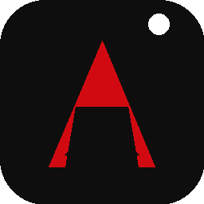

# Agzos Code

> **O VS Code do time Agzos** — editor de código com Electron + Monaco, branding Agzos (#0E0E0E / #D10A11), IA nativa, terminal integrado e multi-plataforma.



## ✨ O que é

**Agzos Code** é um editor de código desktop construído com [Electron](https://www.electronjs.org/) e [Monaco Editor](https://microsoft.github.io/monaco-editor/) (o mesmo engine que o VS Code usa de verdade — não é imitação). Este repositório é a **Fase 0 do roadmap** descrita no PRD: um editor funcional com a cara Agzos, pronto pra evoluir pro fork completo do Code-OSS.

**Diferencial intencional:** o editor foi desenhado desde o dia 1 com o ecossistema Agzos em mente (IA, ferramentas internas, identidade visual) e com privacidade por padrão (telemetria desligada até opt-in explícito).

## 🎯 Features atuais (v0.1)

- **Editor Monaco completo** com syntax highlight, IntelliSense, multi-cursor, bracket pair colorization, minimap, line numbers.
- **3 temas Agzos:** `Agzos Dark` (preto + vermelho), `Agzos Light`, `Monokai` (compatibilidade).
- **Sidebar com 5 views:** Explorer, Buscar, Git, Extensões, Agzos IA.
- **Activity Bar lateral** estilo VS Code.
- **File tree** com expansão lazy, ícones por extensão, context menu (renomear, excluir, novo arquivo/pasta, revelar no SO).
- **Tabs com indicador de dirty** (●) e close on middle-click.
- **Quick Open** (`Ctrl+P`): busca fuzzy por nome de arquivo na workspace.
- **Buscar em arquivos** (`Ctrl+Shift+F`): varre texto nos arquivos da pasta aberta (com skip em `node_modules`, `.git`, `dist`, etc).
- **Terminal integrado** (`Ctrl+`): xterm.js conectado ao shell do sistema (bash/powershell).
- **Command Palette** (`Ctrl+Shift+P`): fuzzy matcher de comandos.
- **Status bar** com Ln/Col, linguagem, encoding, EOL, branch mock e modo de performance.
- **Top bar** com busca rápida e botões de atalho.
- **Settings persistentes** em JSON (tema, performance, telemetria, IA provider/key, fonte).
- **3 modos de performance:** Economia (animações off), Balanceado (padrão), Alta Performance.
- **Atalhos globais** estilo VS Code: `Ctrl+S`, `Ctrl+P`, `Ctrl+Shift+P`, `Ctrl+B`, `Ctrl+` `, `Ctrl+Shift+E/F/G/X`.
- **Branding Agzos:** splash screen, logo, paleta de cores em todos os elementos.
- **Builds multiplataforma** via electron-builder: NSIS (Win) + AppImage/DEB/RPM (Linux) + DMG/ZIP (macOS).

## 🧠 Roadmap (do PRD)

| Fase | Status | Foco |
|------|--------|------|
| **0 — Setup + Branding** | ✅ Concluída (este repo) | Editor funcional com identidade Agzos |
| **1 — MVP Core** | ⏳ Próxima | Wizard de IA, Chat Agent real, Multi-GitHub, Auto-update |
| **2 — Polimento** | ⏳ | Temas Agzos extras, testes de extensões (top 50 do Open VSX) |
| **3 — Integrações Agzos** | ⏳ | Agzos Key (SSO), Browser, Project, Hub |
| **4 — Freemium** | ⏳ | Billing + recursos premium |

> **Decisão consciente de arquitetura:** em vez de fazer fork 1:1 do `microsoft/vscode` (que exigiria semanas só pra configurar o build system do Code-OSS e mais semanas pra cada build multi-plataforma), começamos com um **editor Electron enxuto que já usa o mesmo Monaco** que o VS Code. Migrar para um fork Code-OSS no futuro é viável — o `product.json` e a maior parte do código de aplicação pode ser reaproveitada.

## 🚀 Quick start

### Pré-requisitos
- Node.js 20.x ou 22.x
- npm 10+

### Instalação
```bash
git clone https://github.com/rodrigoazevedo1988/agzos-code.git
cd agzos-code
npm install
```

O `postinstall` roda `tools/setup-vendor.js`, que copia os assets do Monaco e do xterm para `src/renderer/vendor/` (necessário por causa da CSP restritiva do renderer).

### Rodar em dev
```bash
npm run dev
# abre a janela com DevTools anexado
```

### Buildar instalador
```bash
npm run dist          # todas as plataformas (precisa de toolchain)
npm run dist:linux    # só Linux (AppImage + DEB + RPM)
npm run dist:win      # só Windows (NSIS + portable)
npm run dist:mac      # só macOS (DMG + ZIP, precisa de host macOS)
```

Saída vai para `dist/`.

## ⌨️ Atalhos

| Atalho | Ação |
|--------|------|
| `Ctrl+P` | Quick open (buscar arquivo) |
| `Ctrl+Shift+P` | Command Palette |
| `Ctrl+Shift+F` | Buscar texto nos arquivos |
| `Ctrl+S` | Salvar arquivo ativo |
| `Ctrl+B` | Alternar sidebar |
| `` Ctrl+` `` | Alternar terminal |
| `Ctrl+Shift+E` | Ir para Explorer |
| `Ctrl+Shift+G` | Ir para Git |
| `Ctrl+Shift+X` | Ir para Extensões |
| `Esc` | Fechar command palette |
| `Enter` (em campo de busca) | Abrir primeiro resultado |
| Middle-click em tab | Fechar tab |

## 🏗️ Arquitetura

```
agzos-code/
├── package.json              # Electron + electron-builder config
├── src/
│   ├── main/
│   │   ├── main.js          # Electron main process (BrowserWindow, IPC)
│   │   └── preload.js       # contextBridge (API segura pro renderer)
│   └── renderer/
│       ├── index.html       # Shell HTML da UI
│       ├── splash.html      # Splash de boot
│       ├── styles/app.css   # Tema Agzos (CSS variables, dark/light/monokai)
│       ├── scripts/
│       │   ├── app.js              # Entry point / costura
│       │   ├── editor.js           # Monaco wrapper
│       │   ├── tabs.js             # Sistema de abas
│       │   ├── file-tree.js        # Sidebar de arquivos
│       │   ├── terminal.js         # xterm + shell IPC
│       │   ├── command-palette.js  # Overlay de comandos
│       │   ├── ai-chat.js          # UI stub do chat IA
│       │   ├── search.js           # Busca textual
│       │   ├── settings.js         # (legado, mesclado em app.js)
│       │   ├── state.js            # Singleton de estado
│       │   └── toast.js            # Notificações efêmeras
│       ├── vendor/          # Gerado por tools/setup-vendor.js (gitignored)
│       │   ├── monaco/      # Monaco AMD loader + min/vs/
│       │   └── xterm/       # xterm.js + xterm-addon-fit + css
│       └── assets/          # Ícones SVG/PNG
├── build/                   # Assets do electron-builder (ícones, etc)
│   ├── icon.png            # 256x256
│   ├── icon-1024.png       # Master
│   ├── icon.ico            # Windows
│   └── ...
├── tools/
│   └── setup-vendor.js     # Copia Monaco/xterm pra vendor/
├── README.md
├── LICENSE                  # MIT
└── .gitignore
```

### IPC API (preload → main)

Exposta como `window.agzos.*`:

```ts
agzos.app.info()                          // versão, electron, platform
agzos.app.openExternal(url)               // abre link no browser padrão

agzos.fs.readDir(p)                       // lista entries
agzos.fs.readFile(p)                      // { content, size, mtime }
agzos.fs.writeFile(p, content)            // salva
agzos.fs.mkdir(p) / delete(p) / rename(...)
agzos.fs.homeDir()                        // ~/ do usuário

agzos.dialog.openFolder()                 // dialog nativo
agzos.dialog.openFile() / saveFile(path?)

agzos.term.create(cols, rows)             // spawna shell
agzos.term.write(id, data)                // stdin
agzos.term.kill(id)                       // SIGTERM
agzos.term.onData(cb) / onExit(cb)        // stdout, exit

agzos.settings.load() / save(s)           // userData/settings.json

agzos.onMenu(cb)                          // eventos do menu nativo
```

### Segurança

- `contextIsolation: true` (renderer não tem acesso direto a `require`/`fs`)
- `nodeIntegration: false`
- `sandbox: false` (necessário pro preload usar `fs`; isolado via contextBridge)
- CSP restritiva no `index.html` (default-src 'self')
- `will-navigate` bloqueado (links externos vão pro `shell.openExternal`)
- API key de IA guardada em `userData/settings.json` (em produção: mover para `keytar`)

## 🎨 Tema

Cores Agzos (definidas em `src/renderer/styles/app.css`):

| Token | Valor | Uso |
|-------|-------|-----|
| `--accent` | `#D10A11` | Vermelho Agzos (logo, active tabs, cursor, botões primários) |
| `--bg` | `#0E0E0E` | Fundo principal |
| `--fg` | `#E8E8E8` | Texto principal |
| Branco | `#FFFFFF` | Detalhe (logo dot) |

Customizar o tema: edite as CSS variables em `app.css` ou crie um novo bloco `body.theme-<nome>`. Aplique via Command Palette → "Preferências: Tema …".

## 🤝 Como contribuir

1. Fork + branch (`git checkout -b feature/minha-feature`)
2. `npm run dev` para iterar
3. `npm run check` para rodar validações (TODO: adicionar linter + tests)
4. PR descrevendo o que mudou e por quê

## 📋 TODOs próximos

- [ ] Integrar Monaco language workers (TS, JSON, CSS, HTML)
- [ ] Implementar salvamento de API key com `keytar` (cofre do SO)
- [ ] Wizard de primeira execução
- [ ] Chat Agent real (OpenAI / Anthropic / Groq / OpenRouter / Ollama)
- [ ] Multi-conta GitHub (PAT + OAuth)
- [ ] Auto-update via `electron-updater`
- [ ] CI com GitHub Actions (build 3 plataformas)
- [ ] Marketplace Open VSX
- [ ] Temas extras (Agzos High Contrast, Solarized Agzos)

## 📄 Licença

MIT — veja [LICENSE](LICENSE).

Baseado no trabalho de [Microsoft Corporation](https://github.com/microsoft/monaco-editor) (Monaco Editor) e [Sourcegraph](https://github.com/sourcegraph/vscode) (Concourse), ambos sob MIT.

---

**Agzos Code** — feito com 🖤 e 🔴 pelo time Agzos.
