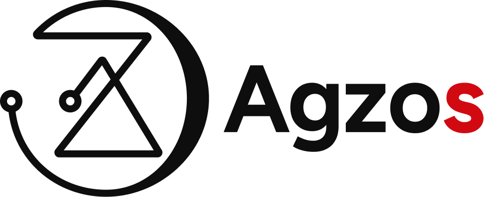

<p align="center">
  <picture>
    <source media="(prefers-color-scheme: dark)" srcset="logos/SVG/2.svg">
    <source media="(prefers-color-scheme: light)" srcset="logos/SVG/1.svg">
    
  </picture>
</p>

<h1 align="center">Agzos Code</h1>

<p align="center">
  <strong>O VS Code do time Agzos</strong> — editor de código com Electron + Monaco, IA nativa, terminal integrado e multiplataforma.
</p>

<p align="center">
  
  
  
  
</p>


---

## ✨ O que é

**Agzos Code** é um editor de código desktop construído com [Electron 44](https://www.electronjs.org/) e [Monaco Editor](https://microsoft.github.io/monaco-editor/) (o mesmo engine que o VS Code usa de verdade — não é imitação). A base é Electron + Monaco próprio, **sem fork do Code-OSS** — decisão registrada no [ADR-0001](docs/decisoes/ADR-0001-base-do-editor.md).

**Estado atual (28/10/2026):** Fase 1.5 — Confiança e integridade em finalização. Próxima: Fase 2 — IA. O roadmap vivo fica em [`docs/plano/ROADMAP.md`](docs/plano/ROADMAP.md).

**Diferencial intencional:** o editor foi desenhado desde o dia 1 com o ecossistema Agzos em mente (IA, ferramentas internas, identidade visual) e com privacidade por padrão — **não há telemetria**.

## 🎯 Features atuais (v0.2)

- **Editor Monaco** com syntax highlight, IntelliSense TS/JS, multi-cursor, bracket pair colorization, minimap e line numbers.
- **3 temas reais:** `Agzos Dark` (preto + vermelho), `Agzos Light` e `Monokai`.
- **Sidebar:** Explorer, Buscar, Git (Fase 3), Integrações Agzos e Agzos IA (Fase 2).
- **File tree** com expansão vertical, ícones por extensão, temas de ícones, context menu (renomear, excluir, novo arquivo/pasta, revelar no SO) e dotfiles (`.env`, `.github` etc.).
- **Tabs** com indicador de dirty (●), fechar com clique do meio e proteção de alterações não salvas ao fechar a janela.
- **Quick Open** (`Ctrl+P`): busca por nome de arquivo na workspace (versão MVP; ripgrep na Fase 4).
- **Buscar em arquivos** (`Ctrl+Shift+F`): inclui dotfiles, ignora `node_modules`/`.git` e leva à linha/coluna do resultado.
- **Terminal integrado** (`Ctrl+`): xterm.js ligado ao shell do sistema por pty real (`node-pty`). `cls`/`clear`, cores, `Tab` e `Ctrl+C` funcionam; se o módulo nativo não carregar, cai para um modo reduzido que avisa na primeira linha.
- **Command Palette** (`Ctrl+Shift+P`).
- **Status bar** com Ln/Col, linguagem, encoding/EOL reais e modo de performance; branch real chega na Fase 3.
- **Configurações em página cheia** (fora da sidebar, `Cmd+,`): tema, ícones, performance, fonte, arquivos ocultos. A configuração de IA fica desabilitada até a Fase 2.
- **3 modos de performance:** Economia, Balanceado e Alta Performance.
- **Atalhos** estilo VS Code: `Ctrl+S`, `Ctrl+P`, `Ctrl+Shift+P`, `Ctrl+B`, `Ctrl+W`, `Ctrl+` `, `Ctrl+Shift+E/F/G/X`.
- **Encoding/EOL/binário:** arquivos Latin-1/UTF-16 são preservados; binários abrem somente leitura; escrita atômica.
- **Assinatura local no macOS** para testes (identidade `Rodrigo Dev Local`, bundle id `com.agzos.code`), sem repetir prompts de pasta a cada rebuild.
- **Builds multiplataforma** via electron-builder: NSIS/portable (Windows x64/arm64), AppImage/DEB/RPM (Linux x64), DMG/ZIP (macOS arm64/x64).
- **Robustez:** logs em `userData/logs`, fallback de erro no renderer, `sandbox: true`, permissões negadas por padrão e instância única.

## 🧠 Roadmap

| Fase | Status | Foco |
|------|--------|------|
| **0 — Protótipo** | ✅ | Editor, branding, welcome/onboarding |
| **1 — Fundação** | ✅ | Lint/testes, IPC modular, cofre, path guard, CI |
| **1.5 — Confiança** | 🚧 | Electron 44, assinatura local, dirty close, encoding, arquivos, busca, status, logs |
| **2 — IA** | ⏳ | SSE, providers, wizard, chat com streaming, contexto e aplicar diff |
| **3 — Git/GitHub** | ⏳ | Status/diff/commit/push/pull, multi-conta |
| **4 — Editor completo** | ⏳ | pty, ripgrep, sessão, performance, importar VS Code |
| **5 — Distribuição/v1.0** | ⏳ | Release 3 SO, auto-update, privacidade, assinatura |

Detalhes, critérios de saída e planos por tarefa: [`docs/plano/`](docs/plano/ROADMAP.md). Decisão de base: [ADR-0001](docs/decisoes/ADR-0001-base-do-editor.md) (sem fork) e [ADR-0002](docs/decisoes/ADR-0002-electron-e-codigo-nativo.md) (Electron 44 + política de código nativo).

## 🚀 Quick start

### Pré-requisitos
- Node.js 22.x (o Electron 44 embute Node 24 no main)
- npm 10+

### Instalação
```bash
git clone https://github.com/rodrigoazevedo1988/agzos-code.git
cd agzos-code
npm install
```

O `postinstall` roda `tools/setup-vendor.js`, que copia os assets do Monaco e do xterm para `src/renderer/vendor/` (necessário por causa da CSP restritiva do renderer).

**macOS — assinatura local para testes:** se existir a identidade `Rodrigo Dev Local` no Keychain, o `postinstall` assina o `Electron.app` de dev com bundle id `com.agzos.code`. Isso dá uma identidade estável ao TCC e evita pedir permissão de Área de Trabalho/Documentos/Downloads a cada rebuild. Para reassinar manualmente:

```bash
npm run sign:mac        # Electron.app de dev
npm run sign:mac:dist   # .app empacotado em dist/
```

Sem o certificado (CI/outra máquina), o script apenas avisa e segue. A assinatura local **não** é notarizada; distribuição exige Developer ID (Fase 5).

### Rodar em dev
```bash
npm run dev         # abre o app
npm run dev:tools   # abre o app com DevTools
```

### Regenerar ícones
```bash
npm run build:icons
```
Gera PNG/ICO/ICNS a partir de `logos/SVG/6.svg` usando o próprio Electron (sem dependências externas). No macOS também aplica nome e ícone Agzos no `Electron.app` de dev.

### Documentação
Veja [`docs/`](docs/README.md): PRD, decisões de arquitetura, troubleshooting e roadmap.

### Buildar instalador
```bash
npm run dist          # todas as plataformas (precisa de toolchain)
npm run dist:linux    # só Linux (AppImage + DEB + RPM)
npm run dist:win      # só Windows (NSIS + portable, x64 + arm64)
npm run dist:mac      # só macOS (DMG + ZIP, arm64 + x64, precisa de host macOS)
```

Saída vai para `dist/`. No macOS, o `.app` local é assinado com a identidade `Rodrigo Dev Local` (quando disponível) via hook `afterPack`; isso serve para teste, não para distribuição. O workflow de build dos três sistemas está em `.github/workflows/build.yml`.

## ⌨️ Atalhos

| Atalho | Ação |
|--------|------|
| `Ctrl+P` | Quick open (buscar arquivo) |
| `Ctrl+Shift+P` | Command Palette |
| `Ctrl+,` | Abrir Configurações (página cheia) |
| `Ctrl+Shift+F` | Buscar texto nos arquivos |
| `Ctrl+S` | Salvar arquivo ativo |
| `Ctrl+W` | Fechar aba (pede confirmação se houver dirty) |
| `Ctrl+Shift+W` | Fechar janela (pede confirmação se houver dirty) |
| `Ctrl+B` | Alternar sidebar |
| `` Ctrl+` `` | Alternar terminal |
| `Ctrl+Shift+E` | Ir para Explorer |
| `Ctrl+Shift+G` | Ir para Git |
| `Ctrl+Shift+X` | Ir para Integrações |
| `Esc` | Fechar command palette |
| `Enter` (em campo de busca) | Abrir primeiro resultado |
| Middle-click em tab | Fechar tab |

## 🏗️ Arquitetura

```
agzos-code/
├── package.json              # Electron + electron-builder config
├── src/
│   ├── main/
│   │   ├── main.js          # Electron main process (BrowserWindow, IPC)
│   │   └── preload.js       # contextBridge (API segura pro renderer)
│   └── renderer/
│       ├── index.html       # Shell HTML da UI
│       ├── splash.html      # Splash de boot
│       ├── styles/app.css   # Tema Agzos (CSS variables, dark/light/monokai)
│       ├── scripts/
│       │   ├── app.js              # Entry point / costura
│       │   ├── editor.js           # Monaco wrapper
│       │   ├── tabs.js             # Sistema de abas
│       │   ├── file-tree.js        # Sidebar de arquivos
│       │   ├── terminal.js         # xterm + shell IPC
│       │   ├── command-palette.js  # Overlay de comandos
│       │   ├── ai-chat.js          # UI stub do chat IA
│       │   ├── search.js           # Busca textual
│       │   ├── state.js            # Singleton de estado (script clássico, carregado antes do app.js)
│       │   ├── welcome.js          # Pop-up de boas-vindas
│       │   ├── onboarding.js       # Wizard de onboarding
│       │   └── toast.js            # Notificações efêmeras
│       ├── vendor/          # Gerado por tools/setup-vendor.js (gitignored)
│       │   ├── monaco/      # Monaco AMD loader + min/vs/
│       │   └── xterm/       # xterm.js + xterm-addon-fit + css
│       └── assets/          # Ícones SVG/PNG
├── build/                   # Assets do electron-builder (ícones, etc)
│   ├── icon.png            # 256x256
│   ├── icon-1024.png       # Master
│   ├── icon.ico            # Windows
│   └── ...
├── docs/                    # PRD, ADRs, arquitetura, roadmap
├── tools/
│   ├── setup-vendor.js     # Copia Monaco/xterm/Lucide pra vendor/
│   ├── build-icons.js      # Gera PNG/ICO/ICNS (roda no Electron)
│   └── patch-electron-dev-mac.js  # Nome/ícone Agzos no Electron.app de dev (macOS)
├── README.md
├── LICENSE                  # MIT
└── .gitignore
```

### IPC API (preload → main)

Exposta como `window.agzos.*`:

```ts
agzos.app.info()                          // versão, electron, platform
agzos.app.openExternal(url)               // abre link no browser padrão

agzos.fs.readDir(p)                       // lista entries
agzos.fs.readFile(p)                      // { content, size, mtime }
agzos.fs.writeFile(p, content)            // salva
agzos.fs.mkdir(p) / delete(p) / rename(...)
agzos.fs.homeDir()                        // ~/ do usuário

agzos.dialog.openFolder()                 // dialog nativo
agzos.dialog.openFile() / saveFile(path?)

agzos.term.create(cols, rows)             // spawna shell
agzos.term.write(id, data)                // stdin
agzos.term.kill(id)                       // SIGTERM
agzos.term.onData(cb) / onExit(cb)        // stdout, exit

agzos.settings.load() / save(s)           // userData/settings.json

agzos.onMenu(cb)                          // eventos do menu nativo
```

### Segurança

- `contextIsolation: true` (renderer não tem acesso direto a `require`/`fs`)
- `nodeIntegration: false`
- `sandbox: true` na janela principal
- CSP restritiva no `index.html` (default-src 'self')
- `will-navigate` bloqueado (links externos vão pro `shell.openExternal`); webviews bloqueadas; permissões negadas por padrão
- API keys e tokens no cofre do SO (`safeStorage`), nunca no `settings.json`; o renderer não lê o valor
- Acesso a arquivos restrito às raízes liberadas (path guard com `realpath`)

## 🎨 Tema

Cores Agzos (definidas em `src/renderer/styles/app.css`):

| Token | Valor | Uso |
|-------|-------|-----|
| `--accent` | `#D10A11` | Vermelho Agzos (logo, active tabs, cursor, botões primários) |
| `--bg` | `#0E0E0E` | Fundo principal |
| `--fg` | `#E8E8E8` | Texto principal |
| Branco | `#FFFFFF` | Detalhe (logo dot) |

Customizar o tema: edite as CSS variables em `app.css` ou crie um novo bloco `body.theme-<nome>`. Aplique via Command Palette → "Preferências: Tema …".

## 🤝 Como contribuir

1. Fork + branch (`git checkout -b feature/minha-feature`)
2. `npm run dev` para iterar
3. `npm run check` (lint + testes unitários) e `npm run test:e2e` (Playwright; no Linux sem display use `xvfb-run -a npm run test:e2e`)
4. PR descrevendo o que mudou e por quê

## 📋 Próximas fases

- [ ] **Fase 2 — IA:** wizard, chat com streaming, contexto e aplicar diff
- [ ] **Fase 3 — Git/GitHub:** status/diff/commit/push/pull e multi-conta
- [ ] **Fase 4 — Editor completo:** pty, ripgrep/Quick Open, sessão e importar VS Code
- [ ] **Fase 5 — Distribuição:** release 3 SO, auto-update, privacidade e assinatura Developer ID
- [ ] Pós-v1.0: integrações Agzos (Key/Browser/Project/Hub), LSP, agent e freemium

## 📄 Licença

MIT — veja [LICENSE](LICENSE).

Baseado no trabalho de [Microsoft Corporation](https://github.com/microsoft/monaco-editor) (Monaco Editor) e [Sourcegraph](https://github.com/sourcegraph/vscode) (Concourse), ambos sob MIT.

---

**Agzos Code** — feito com 🖤 e 🔴 pelo time Agzos.

## 🎨 Identidade visual

Os logos oficiais da Agzos ficam em [`logos/`](logos/), em **SVG**, **PNG** e **PDF**:

| Arquivo | Versão | Uso indicado |
|---|---|---|
| `1` | Logo completo, preto com "s" vermelho | Fundos claros |
| `2` | Logo completo, branco com "s" vermelho | Fundos escuros |
| `3` | Logo completo, preto | Impressão monocromática em fundo claro |
| `4` | Logo completo, branco | Monocromático em fundo escuro |
| `5` | Símbolo, branco | Ícones e avatares em fundo escuro |
| `6` | Símbolo, vermelho (#D10A11) | Destaque, favicon, splash |
| `7` | Símbolo, preto | Ícones em fundo claro |

Paleta: preto `#0E0E0E` e vermelho `#D10A11`.
